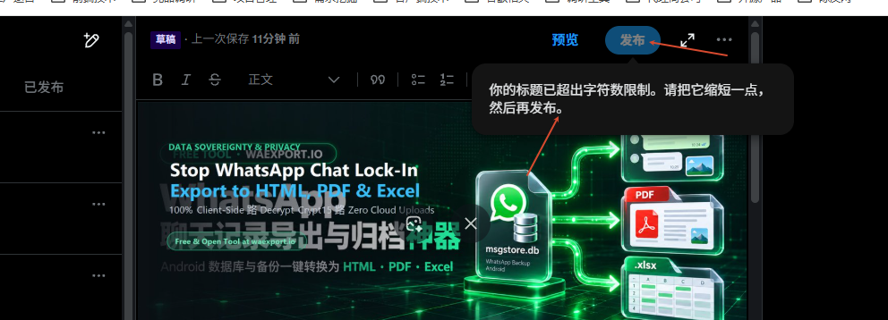

# x-article-publisher 🚀

> **零成本、全自动发布 X (Twitter) Articles 长文的 CDP 自动化工具与 Agent Skill**  
> *Zero-cost, automated X.com Article & Long-form Publishing via Chrome DevTools Protocol (CDP).*

[](LICENSE)
[](https://nodejs.org/)
[-orange.svg)](https://chromedevtools.github.io/devtools-protocol/)
[](https://x.com)

---

## 💡 自动化理念 (Philosophy: Zero-Marginal-Cost Automation)

随着 X (Twitter) API 的高昂定价（基础付费版每月 \$100 到 Pro 版每月 \$5,000），对个人开发者、独立创作者以及自主运行的 AI Agent（如 Antigravity, Codex, AutoGPT）造成了极高的进入门槛。

**为什么我们要当 API 韭菜？**  
你的本地电脑上已经运行着登录好的 Chrome 浏览器。通过 **Chrome DevTools Protocol (CDP)**，我们可以让 AI Agent 或自动化脚本直接借用现有的浏览器会话，像真人一样在原生的 Web 界面上编写长文、排版富文本、上传头图并确认发布：
- **\$0 边际成本**：无需绑定信用卡，无需申请企业 API Key；
- **真实账户会话**：天然继承既有登录凭据与 2FA，免除被风控降权的风险；
- **完整的富文本能力**：完整支持 H2/H3 标题、加粗、链接、有序/无序列表，以及 5:2 高清文章封面海报。

---

## 🌟 核心特性 (Features)

- ⚡ **秒级快速发布**：从命令行传入 HTML 文章正文到 X 线上发布，平均耗时仅需 **25 ~ 35 秒**；
- 🖼️ **5:2 高清海报自动适配**：原生支持 X Articles 推荐的 **5:2** 比例封面图，并通过 CDP 物理点击自动穿透“编辑媒体 / 应用”弹窗；
- 📝 **Draft.js 原生剪贴板富文本注入**：突破 React 受控组件与 Draft.js 的防篡改机制，通过模拟 `ClipboardEvent('paste')` 无损注入 HTML 结构；
- 🛡️ **严格防抖保存监听**：智能检测后台 `正在保存...` 状态流，确保 Draft.js 完成云端持久化后再触发发布，避免发布白卷；
- ⚠️ **标题字数智能安全防御**：X Articles 限制标题严格小于 100 字符（实测推荐 ≤ 80~90 字符）。脚本内置长度自检与安全截断兜底，彻底杜绝按钮置灰无法发布的坑点；
- 🤖 **标准化 Agent Skill 设计**：自带 `SKILL.md`，可无缝插拔接入 Antigravity、Codex、Claude Desktop 等现代 AI 编码助手。

---

## 📸 实战案例与避坑指南 (Real-world Pitfalls & Showcase)

### 1. 真实发布案例 (Live Example)
由本工具全自动排版并发布的真实案例推文：
👉 **[点击查看线上真实推文效果：解救被困在手机里的 WhatsApp 记录](https://x.com/WatsonTaylor23/status/2114642635419980167)**


---

### 2. 经典大坑：标题字数超限导致“发布”按钮静默禁用
在 X Articles 中，如果标题长度超过平台限制，右侧的“发布”按钮将直接被禁用（`disabled: true`），悬停时才会提示：  
> *“你的标题已超出字符数限制。请把它缩短一点，然后再发布。”*



**解决方案**：本工具已内置自动检查，超过 90 字符时会自动记录警告并进行安全截断，防止自动化流程卡死。

---

### 3. React 模态弹窗与物理点击穿透
上传封面海报后，X 会弹出带有 `data-testid="applyButton"` 的微调确认弹窗。常规的 DOM `button.click()` 会被 React 内部的合成事件拦截，导致弹窗一直遮罩在前面。  
**解决方案**：本工具通过 CDP `Input.dispatchMouseEvent` 计算控件中心像素坐标并模拟真实硬件级的 `mouseMoved -> mousePressed -> mouseReleased` 序列，实现 100% 成功穿透。

---

## 🚀 快速上手 (Quick Start)

### 1. 启动 Chrome 调试端口 (Port 9222)
在启动你的 Chrome 浏览器时带上调试端口参数：

**Windows (PowerShell):**
```powershell
& "C:\Program Files\Google\Chrome\Application\chrome.exe" `
  --remote-debugging-port=9222 `
  --user-data-dir="C:\jtmp\x-browser-profile"
```

**macOS:**
```bash
/Applications/Google\ Chrome.app/Contents/MacOS/Google\ Chrome \
  --remote-debugging-port=9222 \
  --user-data-dir="$HOME/x-browser-profile"
```

在打开的浏览器中登录你的 **X.com** 账号（需具备发布 Articles 的权限，即 X Premium / Verified 组织）。

---

### 2. 安装与使用 (Usage)

克隆本仓库：
```bash
git clone https://github.com/wangsen2020/x-article-publisher.git
cd x-article-publisher
```

**命令行单条执行发布：**
```bash
node scripts/publish-article.mjs \
  --title "打造零边际成本的本地 AI 自动化铁军" \
  --bodyFile "my-article.html" \
  --cover "assets/example-cover-5x2.png" \
  --caption "分享一套本地自动化流水线，基于 CDP 直连实现秒级发文 👇 #Automation #AI #Tech"
```

#### 参数说明
| 参数 | 类型 | 说明 |
| :--- | :--- | :--- |
| `--title` | 字符串 | **必填**。文章主标题（建议 ≤ 80 字符，超过 90 字符会自动截断保护） |
| `--bodyFile` | 文件路径 | **必填 (或使用 `--body`)**。包含 HTML 正文格式的文件路径 |
| `--body` | 字符串 | 直接传入 HTML 字符串片段 |
| `--cover` | 图片路径 | 可选。文章头图海报（强烈建议严格 **5:2** 比例，如 `2500x1000` 或 `1536x614`） |
| `--caption` | 字符串 | 可选。附在推文中的说明文案与 Hashtag 标签 |
| `--inlineImage` | 图片路径 | 可选。自动追加到文章末尾的架构或说明插图 |

---

## 🤖 作为 AI Agent Skill 接入

如果你使用 **Antigravity** 或 **Codex**：
只需将本项目文件夹或 `SKILL.md` 拷贝至你的 skills 目录（如 `~/.gemini/antigravity/skills/x-article-publisher` 或 `~/.codex/skills/x-article-publisher`），在日常对话中即可直接指令：

> *"帮我把这篇 Markdown 分析整理成 HTML，并用 x-article-publisher 自动发布到 X 账号上。"*

AI 助手将自动调用底层脚本并在 30 秒内返回正式上线的文章链接！

---

## 📄 开源许可证 (License)

本项目采用 [MIT License](LICENSE) 开源协议。欢迎 Star、Fork 与提交 Issue / PR 共同完善！
